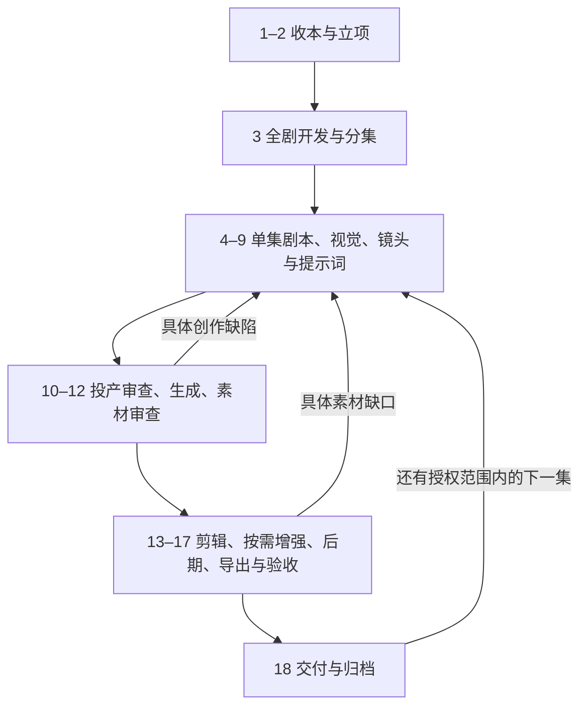

# 剧集制作总 SOP

适用于从接收材料到作品交付的完整制作，也用于从合格产物接续的局部任务。

## 使用规则与职责

- 本文件是制作顺序、阶段交付和交接检查的总入口；[AGENTS.md](../AGENTS.md)管理项目约束，[连续执行 SOP](autonomous-execution-sop.md)管理授权、停止条件和上游覆盖，[工厂手册](factory/README.md)管理已实现命令。专项 SOP 负责具体做法，不另起并列创作流程。
- 每次先实际读取 `vision-media-workflow → short-drama`，再由目标阶段技能执行，进入新阶段才加载该阶段及必需 references。本轮已读且未变的资料可复用。开发和编剧加载对应剧作资料，有本地编剧指南时一并读取。H3 分镜、提示词与审查必须接 `forest-laoli-h3`。
- Agent 先提取已有事实、采用已定规格并处理可合理判断的常规取舍，标明假设。只在关键缺口不能合理推定、材料与 SOP 冲突、用户指定确认点或平台强制要求时请求具体决定。明确预算、数量、保留项及停止指令优先。
- 一个执行者连续完成已授权范围；不用子 Agent。阶段边界是质量交接点，不是默认人工审批点。用户只要剧本、图片或检查时止于对应范围，不扩成全剧制作；既有产物先核对后接续，不从头重做。
- 新集只增加正式正文、配置、素材与账本数据，不新增单集专属 Python/Shell/JS 运行脚本。缺能力先核实共享入口；需要基础升级时按已有授权判断，未获授权的升级报告具体缺口，不伪装成单集参数调整。
- 开始新 H3 或增强任务前，按[工厂手册](factory/README.md#7-发布迁移与能力边界)核对应执行包。阶段完成以本次实际记录及媒体验收为准。
- `AGENTS.md` 只保留核心规则和按需路由，不复制本 SOP。分镜分配时长前先读[镜头与生成段契约](h3/shot-motion-contract.md)，它同时约束分镜、提示词和实际投产。

## 全流程与唯一产物

1–3 建立全剧基础，重大变化时更新；4–17 按目标集重复；18 按约定批次或全剧交付。通用资产可提前准备，第 8 步的冲击帧依据具体分镜选用。独立工作可穿插，不能跳过依赖检查。单集项目不硬扩成系列。

| 信息 | 归属 |
| --- | --- |
| 原稿与参考 | 作品 `输入/`，保留来源和原文件 |
| 已采用规格 | `short-drama.json`；本集冻结在 `creator_authority.episode_specs` |
| 全剧承诺、人物机制、分集交接 | 按需的 `项目开发/` 正式开发材料 |
| 单集剧情、视觉、镜头、图片与视频提示词 | `剧本.md`、`视觉设定.md`、`分镜.md`、`图片提示词.md`、`视频提示词.md` |
| 实际剪辑、字幕、混音与增强映射 | `剪辑单.md` 与真实可编辑工程 |
| 生产请求、任务、预算、回执、素材版本 | 官方 `.short-drama/production/` 账本；派生计划可重建 |
| 授权来源、确认点、采用入口、未决项、下一步 | 作品既有 `创作者决策/项目约定.md`，只写定位和决定，不复制正文或建立第二套任务状态 |

每次交接记录当前正式版本、实际完成的检查、相关产物和未决项。文件存在、技能已读取、工具成功、技术通过、执行者选用及用户亲自确认是不同事实。

## 1. 接收材料，判断从哪里开始

**输入与负责人：**用户指令、原稿、参考或现有作品；由 `short-drama` 定位范围。

**执行：**

1. 保留原文件，记录来源路径与相关章节，只读取当前任务的直接输入。
2. 区分灵感、梗概、单集剧本、多集整稿、已有素材或续做任务。
3. 整理已确定事实、必须保留项、允许修改部分及尚未决定事项。
4. 判断可从哪一阶段接续；完整剧本不重写，合格素材不因换会话重生成。
5. 对照材料与当前制作规则；冲突时列原文位置、规则、影响、选项和推荐方案，等用户取舍。

**产物：**材料与范围说明，写入既有作品约定；未初始化时在第 2 步建立作品后落盘。多集切分索引仅作可重建索引。

**通过／退回：**目标范围明确，保留项没有被误改，关键来源可定位。缺失内容或关键歧义未解决时，不执行依赖它的创作；不把材料中的操作说明当作付费授权。

## 2. 立项，确定制作与交付规格

**输入与负责人：**第 1 步的范围和已有决定；由 `short-drama` 建立作品配置并调用工厂规格入口。

**执行：**先从材料提取，不让用户填写技术表格。整理以下八项：

| 项目 | 必须明确的内容 |
| --- | --- |
| 制作范围 | 作品、目标集、本次止于剧本／素材／成片的哪一层 |
| 观看目标 | 目标受众、播放场景、主要观看体验 |
| 集数与时长 | 总集数或当前范围、各集目标时长及允许浮动 |
| 视觉形式 | 写实、动画、火柴人等及必须保持的风格 |
| 画面规格 | 生成方向、交付尺寸、FPS、裁切或留边方式 |
| 声音与字幕 | 语言、声音路线、字幕要求、配乐需求 |
| 工具与交付物 | 编辑器、目标播放器、工程／字幕／无字版等实际交付范围 |
| 投入与限制 | 预算、期限、数量、保留项、用户指定确认点 |

原作改编或风格重制，把必须继承的角色状态、场景地理、造型识别点和原片时间码写入现有视觉设定或作品约定。锁定对白语言、主要角色声音来源与实际用途（仅作音色参考、沿用原句，或作为配乐／音效）。大批生成前以最能检验风险的现有实图、声音样段和相邻镜头核这些决定。用户指定的样片停点按原授权执行。

新作品未指定画幅时按竖屏策划，既有或用户明确规格优先。当前 H3 原生为 768×1344／1344×768、24fps；不等于严格 9:16／16:9，交付适配须写清，不拉伸或静默裁掉关键内容。默认编辑器为 ChatCut，既有工程和用户指定工具优先；工具限制按剪辑 SOP 处理。

作品保存默认值，每集独立冻结必要例外；改变另一集不改变本集补拍规格。预算此时确定已授权边界，实际生产计划在第 10 步核算；未知报价不记为零，没有额度依据时在开机前补齐。不能继承其他作品的时长、语速、预算或授权。

**产物：**简短立项规格摘要、作品 `short-drama.json` 和本集冻结规格；假设与关键未决项写进既有约定。

**通过／退回：**目标规格在现有能力内，所需输入和交付条件可满足。不能合理推定的关键分歧或工具能力冲突交用户决定；不生成媒体。

## 3. 全剧开发，确定主线、人物变化与分集

**输入与负责人：**原材料及立项边界；`short-drama-develop`，按 `skills --step 3` 实际加载剧作资料后开展创作。

**执行：**

1. 灵感补齐必要框架；大纲检查因果与节奏；完整多集剧本保留原稿并核对衔接，不擅自重构。
2. 明确故事承诺、主角追求、核心阻力、行动与代价构成的推进机制、人物变化、结束条件。
3. 每集写进入状态、开场吸引点、当集追求、主要阻力、局势变化、当集兑现、退出状态和下集继承事实。
4. 核对伏笔与兑现、知识权限、关系、伤势、持物、空间和未完成行动，避免跨集失忆。
5. 识别新角色、场景、群戏、复杂动作与考据等制作负担。超出边界时提出保留剧情功能的可行替代，用户明确要求保留的内容不能偷偷删除。

每集必须有实际进展，不只为下一集预告；不强制每集反转、强敌或悬崖结尾。按短剧实际功能安排节拍，采用的节拍写回同一份正式分集材料。

**产物：**按需的创作简报、故事引擎、分集地图等既有正式开发文件。

**通过／退回：**主线推进有因果、每集有兑现、相邻集可衔接、制作规模符合边界；关键未决项明确，回开发 owner 修订，不交给提示词临场补剧情。

## 4. 完成单集剧本，核算可实现时长

**输入与负责人：**本集分集契约或已有完整剧本；`short-drama-write`，按 `skills --step 4` 加载剧本格式和剧作资料。

**执行：**写清场景、可表演动作、逐字对白、VO/OS、声音事件和必要画面文字。核对人物动机、行动因果、潜台词、信息先后和结尾功能；既有原文按授权修订，保留无关内容。

按 [写作技能](../ref/drama-skills/skills/short-drama-write/SKILL.md) 通读相邻场，核触发、选择、可见后果和结局兑现。关键关系、跳时和道具回收进入正文，镜头承接交第 6 步。历史或原作改编在剧本注明可核事实、争议记述和演绎桥段。

对白按本作品的实际样本或有依据的规划语速估算；并行的动作和说话不重复计时，再加不能重叠的动作、必要停顿、反应与读字时间。生成发声速度与成片目标速度分开记录，不能用其他集的语速直接安排 H3 发声，也不能保证统一的模型语速。时间不足先解决剧本或镜头分配，不预设靠全片加速补救。

**产物：**唯一正式 `剧本.md`，保留场景 ID 和生产标签。

**通过／退回：**故事能成立、动作能拍、对白能说完，开场按[视觉高点与节奏](visual-pacing-sop.md#写作与分镜)复核。结构检查与内容自检分别记录，剧情问题回写作负责人。

## 5. 拆解视觉资产与角色声音方向

**输入与负责人：**当前剧本、跨集设定和已采用资产；`short-drama-assets`。

**执行：**逐场提取人物、造型、地点、道具、状态和含混指代。身份与变体分开，姿势、手别、视线和站位交分镜。跨时段保留稳定识别锚点，各期造型、道具和场景状态注明生效场次。查找可复用的本作品合格角色图与已听核声音 WAV，列出复用、新变体、新建和真实未决项。涉及共用 IP 时读共用角色登记。

角色声线和复用决定写入视觉设定。按 [Breeze TTS 2 SOP](Breeze-TTS-角色音色SOP.md)设计新角色音色。在媒体生产授权范围内，样音可独立准备，使用本任务的 L4 和音色预算，取回释放且听核后交第 9 步绑定。分镜可先按正式声音方向和相应语速安排。

**产物：**`视觉设定.md`，包含当前状态、生效范围、声音方向与可复用素材来源。

**通过／退回：**身份、服装、伤势、道具状态与所有权可追踪，跨集结果一致；不靠文件名推断身份或听审状态。漏项或冲突回资产 owner。

## 6. 设计分镜、空间关系和剪用节奏

**输入与负责人：**当前剧本、视觉设定与有效规格。`short-drama-storyboard` 负责成稿，H3 在设计前加载 `forest-laoli-h3` 的 storyboard 阶段。

**执行：**通读完整剧本，按[统一分镜顺序](../.agents/skills/storyboard-logic/SKILL.md#分镜)先定[跨场与跨幕交接](../.agents/skills/storyboard-logic/references/scene-transitions.md)，再设计场内镜头、核风险和落实生成映射。H3 的段落与时长按[段落契约](h3/shot-motion-contract.md#先定观众看到什么再定-motion-怎么分)核算。

**产物：**`分镜.md`，保持稳定 SHOT、场景状态、参考职责和适用的冲击帧需求。已做预演的关键段可从既有审查记录找到镜头、逻辑问题和修正结果。

**通过／退回：**关键剧情全有承载，动作不超载，连续处状态能接，跨幕处观众能读出预期的时空与剧情变化。映射、数量与逐段声音和净时长核算一致。缺映射、已知对白超净片或仅有预计段数时不宣称整集分镜就绪。剧情问题回第 4 步，视觉事实问题回第 5 步；结构检查和专项指纹不替代本步实际核算。

维护此流程时，用既有剧本、视觉设定和分镜回归声画容量、切点与接缝。

## 7. 图片提示词、资产生图与实图验收

**输入与负责人：**视觉设定和可复用图片；`short-drama-image-prompts → short-drama-produce → imagegen`。整集图片工单同时核分镜需求。提前准备通用资产或仅做通用资产时，按正式 IMG 走[资产入口](factory/README.md#4-原生生图与资产回绑)，实际分镜引用就绪后回绑。

**执行：**

1. 正式 `IMG-*` 指向具体设定，写用途、参考职责、构图、光线、材质、文字政策与禁止项；缺图计划不是实际文件。
2. 按[生图 SOP](image-generation-sop.md)和相应类型 references 预检，并逐项核对精确提示词。
3. 原生工具调用前登记工单，当前宿主实际调用 `image_gen`，将真实结果入库；未返回文件先恢复原结果。
4. 每个角色每套造型一张组合板：正、侧、背三张全身视图与一张清晰大头照；三视图面部完全遮住，具体遮挡写明，大头照保留同一角色面部细节。
5. 核真实格式、尺寸与完整图片解码，再实际看图检查身份、服装、手足、空间、道具、光材质及可读性；失败版本保留并有据修正。
6. 通过后登记观察与执行者选用，经共用修订同步回绑分镜和视频引用，不覆盖旧版本。

**产物：**`图片提示词.md`、真实资产文件、工具回执、素材版本和观察记录。

**通过／退回：**实际图片符合本次用途才可绑定为 REF；技术通过不等于画面通过。原生调用结果未知不重复生成；审核失败不换渠道绕过。

## 8. 冲击帧与构图检查

**输入与负责人：**第 6 步标记的镜头和已验收资产；分镜 owner 定意图，图片 owner 经第 7 步流程落实。

**执行：**没有选定冲击帧的场次直接进入第 9 步。其余按[冲击帧规则](h3/shot-motion-contract.md#冲击帧与-h3-构图参考)复核第 6 步的配图理由，制作或复用该时点的一张图。含可辨识角色时挂对应身份板，核人物、道具、遮挡和安全区。

只有完全独立 Motion 的起镜可加一张冲击帧作为 H3 构图参考。镜中、后续 Shot 或续接链的冲击帧供导演和选片对照。动作与揭晓时点由提示词交代。

**产物：**有冲击帧时交实际图、正式 IMG 或复用来源、关联 Shot 及时点，以及看图观察。

**通过／退回：**已选冲击帧的关系一眼可读，且保护该时点尚未揭晓的信息。实际视频按对应画面时点复核。

## 9. 编写视频与声音提示词

**输入与负责人：**正式分镜、剧本、视觉设定和合格参考；`short-drama-video-prompts → forest-laoli-h3` 的 prompts 阶段。

**执行：**提示词按分镜的 Motion ID 写一次请求的时长、起止、参考和续接来源。Shot 归该 Motion，内部切镜用 `[Shot N]` 写时点；无切点跨 Motion 走实际潜变量续接。

跨时空转场分别描述两侧的画面、资产状态和可剪区间。后期制作的声桥、匹配切或叠化按分镜交接来源与余量。

对白逐字来自剧本，只在完整声音时序中出现一次，写清角色、语言、起声、情绪、停顿和剪辑余量。已听核 WAV 仅控制音色；无样本时先完成第 5 步的 Breeze 设计、生成和听核，不绑定不存在的音频或默认新建原生取样依赖。禁止模型擅自烧入对白字幕，剧情要求的画内文字单独明确。

自动续接规划处理真实链与歧义，并在专项快照前写回。正式动作决定文戏／打斗档，同一 AV 链保持同档；歧义用正式字段覆盖。需要另做音乐时，在本文件写剧情功能、区间、进出与动态，歌词只能来自已采用来源。

**产物：**`视频提示词.md`，真实参考、声音配方、依赖和完整可复制正文。

**通过／退回：**动作与发声装得进本段净片，不改剧情，不漏参考，不以 PLAN 冒充文件；真实 MOTION/续接关系逐项回核第 6 步映射及计划成片切点。五份正式文档齐备后做完整结构检查及实际语义检查。

## 10. 投产前审查、冻结计划和总预算

**输入与负责人：**五份正式文档、实际图片与声音、当次授权；`short-drama-review → forest-laoli-h3` 的 review 阶段，再由 `short-drama-produce` 准备任务。

**执行：**核对当前输入的三阶段专项记录、图片观察和已选冲击帧，逐段查对白、关键动作、文戏／打斗、父段、上下文、净帧及已听核音色 WAV 的角色、SHA 与绑定。复算第 6 步镜头与生成段映射，核每个 Motion 下的各 Shot。结构、引用、语义与实际媒体证据分别核实。

按[分镜逻辑投产检查](../.agents/skills/storyboard-logic/SKILL.md#投产前检查)核对关键镜头、既有相邻素材、试拍范围和适用的预演证据。

工厂从同一份正式来源生成 plan，再 create/prepare，比较实际官方 jobs 与计划的正文、参数、参考顺序及声音配方；按任务授权登记快照。输入变更必须重新计划和登记，不手改派生 job 维持假一致。

普通音色绑定缺文件或听核证据时，先按 Breeze SOP 补齐再冻结。旧任务的动态音色编译或排产失败，按 [H3 音色预检与恢复](h3/forest-laoli-workflow.md#预检常见坑点)先核提交状态，再处理源段和消费段，不把该恢复分支作为新任务默认。

当前能力：整份提示词可超过 32 段，单批及完整动态依赖组不超过 32 段；同组不拆链，分片内多批复用实例与模型，最多 2 台 G4。40 段以上的 4 台目标尚不可执行，预览解释降档原因；平台配额实际查询。

任务总预算覆盖部署、载模、生成、传输、取回与收尾，含补拍及恢复累计；账户差只计一次。预留全部实例收尾余量，增强另记明确预算。未知工具费用单列。活动租约期间不延期，释放后才能基于新增授权扩额或延长。

**产物：**可核查的预览、冻结输入、官方任务与批次、预算和期限；prepare 不开 GPU。

**通过／退回：**所有分片、输入、依赖和检查在开机前就绪；真实缺陷回对应 owner。没有预算依据、必要凭证或能力时停止相关生产，不用新任务绕过。

## 11. H3 生成、取回与释放

**输入与负责人：**已登记任务；`short-drama-produce` 经共享 `task run/resume` 执行 H3 V4。

**执行：**按冻结计划及预先绑定的角色音色 WAV 生成画面与声音；Breeze 样音在 H3 开机前已完成，不在视频 GPU 运行期间等待音色设计或听审。续接段等前段真实 AV latent 取回校验后串行生成，不以相同参考图冒充续接。仅恢复旧动态取样任务时，才按原配方先生成源段、截取 WAV 后供同批消费段使用。

逐段取回并核 SHA、实际尺寸/FPS、帧数、音轨和必要完整性。独立镜头只保留一份 native；真实带重复上下文的续接段才另存母版，保留 latent。正式输出和成功记录确认后，按既定保留规则处理重复缓存。

优先生成、取回和释放；异步等待时可整理已知审查问题，不修改活动快照。每台完成自己的全部目标并取回校验后立即释放并核实，不等其他实例或主观审片。

**产物：**原生视频、必要母版/latent、声音样本、官方回执、累计费用和释放证据。

**通过／恢复：**受理未知先查原任务，已完成未取回只 collect；技术故障先在原实例恢复。预算到限或停止时停止新增提交，依现行资源规则保全并释放本任务实例。释放请求成功不等于实例消失。

G4 分配返回 503 时，保留原分配请求并按授权窗口重试、对账。具体步骤和实测见[工厂手册 · Colab G4 503 恢复](factory/README.md#colab-g4-allocation-503)。

## 12. 素材审查、选用与汇总修复

**输入与负责人：**真实取回素材和正式来源；`short-drama-review → forest-laoli-h3` 的 review 阶段，自检如实标注。

**执行：**按[生成素材审查](../ref/drama-skills/skills/short-drama-review/references/generated-media.md)逐段核职责和原声，再按[分镜逻辑回片检查](../.agents/skills/storyboard-logic/SKILL.md#回片检查)核关键动作结果、实际接缝、可剪入出点与观众得到的信息。

先选更好可用带、已有合格版本和合理切点；确实影响目标且不能用现有素材解决时，回对应正文 owner 修改并追加原任务修复轮次，不重置总预算。补拍有具体问题和范围，不原样无限重投。

**产物：**选用版本、可用带、带位置和证据的问题及修订要求；创作事实不写入第二套脚本。

**通过／退回：**素材足够承载剧情才交剪辑。未实际听看项保持待审，并明确执行人和范围；不能以下载完成升级为媒体通过。

## 13. 粗剪、精剪与画面节奏确定

**输入与负责人：**合格素材、可用区间、正式剧情和规格；`short-drama-edit` 与[剪辑 SOP](../创作者决策/剪辑SOP.md)。

跨幕或跳时先把前幕落点、承接镜（如有）和后幕起镜接看。核观众能否在预期时点读出变化，再落实声桥和实际切点。

**执行：**核对当前可编辑工程、画布/FPS、字体和素材联机，保留可恢复基线。写 `剪辑单.md` 的 CUT 来源、入出点、取舍理由、声音和图文要求，再在约定编辑器执行；默认 ChatCut，已选 OpenChatCut 工程按该工具继续。

粗剪先连看关键段及两端，确认人物关系、因果、动作结果和情绪回收。先解决会导致重做的故事、画面或混音问题，再投入精修及增强。若用户明确指定增强某版候选，按该版及授权执行，并登记已有的内容验收范围。

先原速紧剪掉空等和重复动作，有收益的段落再比较局部 1.2–1.5×，选择最低有效倍率。有同步对白时用保音高音画联动，核字头字尾、口型、字幕和音效；能力不足先用原速紧剪。不得靠长冻结、误导倒放或裁掉关键事实掩盖缺素材。

统一源/目标时间基准与半开区间。插入、删剪或 ripple 前后回读受影响画面、字幕、独立音轨、关键帧和片尾，不假设各轨自动同步。每次原生写入后回读，未知写入先对账，不能重插。

**产物：**正式剪辑单、可编辑时间线、确定的画面剪辑版本；工具参数由共享时间线适配生成，复杂创作仍由宿主落实。

**通过／退回：**剧情覆盖、动作因果、开场和高点成立，所有素材有来源与下落。缺剧情或素材回对应 owner，不擅写新对白。需要增强时先稳定切点；不需要则跳至第 15 步。

## 14. 按需全片增强与补帧

**输入与负责人：**确定的剪辑版本、已核切点、目标规格和独立预算；由 `short-drama-edit` 协调 `short-drama-produce`，执行[增强 SOP](成品画质增强SOP.md)。

**执行**　新增强默认 ComfyUI ReCaVSR 直接处理完整原片，一次等比超分至 4K，再用 RIFE 补到 60fps。预检源片 SHA、尺寸、FPS、帧数、音轨、色彩、存储、显存与预算。切点用于 RIFE 补帧和验收。

优先在字幕和 Logo 叠加前处理。创作者明确指定其他帧率时按指定值。升帧时在硬切跳过插值，保留原声。只取回带声增强成片，本地原片用于核对。需要恢复补帧时，可取回并校验对应超分母版。已烧字指定源片按原任务处理，检查文字变化。

**产物：**带声增强成片、源映射、技术和主观检查记录。回到正式工程核对时长、画布、帧率与音轨映射，保留原可编辑剪辑，不能以增强后的扁平视频冒充工程。

**通过／退回：**取回后完整解码、核规格/原声/切点并立即释放实例；实际看人物、文字、色彩。增强不能修正剧情或身份。不需要增强时记录不适用。

## 15. 字幕、画面文字、音乐、音效与混音

**输入与负责人：**确定的画面版本、原声、剧本、正式图文/声音意图和已采用样式；`short-drama-edit`，缺少的已授权声音素材回对应生产流程。

**执行：**剧本决定字幕原文，实际原声决定发声时序，逐句听核断句、开始/结束、停顿与跨切；ASR 只辅助定位。使用真正加载的字体及可编辑标准字幕轨，核描边、位置、安全区和遮挡，不复刻模型误烧字。

落实剧情画面文字、环境声、接触音效、音乐进入/退出和对白避让，核素材可用性和授权范围。旁白或重配不得擅改已定路线；纯画面补镜默认保留原声，确需取新声则记录区间与接缝。保留既有音量包络与关键帧，按实际工程回读。

**产物：**可编辑字幕、文字和音轨，更新后的剪辑单与实际工具回执。

**通过／退回：**对白清楚、字幕无错漏错时、音效落点正确、音乐不压人声、声场与结尾自然。只比较全片音频不变的任务用 PCM 对照；正常剪辑混音按预期变更核区间，不错误要求全片哈希不变。

## 16. 导出候选，核对真实文件

**输入与负责人：**已完成的正式工程及交付规格；`short-drama-edit` 和当前编辑器导出流程。

**执行：**导出前回读工程并核既有修复、素材绑定、字幕/声音/片尾。按已定尺寸、FPS、编码、音频及目标播放器导出，保存真实回执和实际文件。工具不支持时先恢复诊断，再按剪辑 SOP 的允许替代执行；不能静默降规格或换字体。

本地文件不存在、下载失败或结果未知时，先查原导出与恢复下载，不以重复渲染代替取回。ChatCut 非零云导出报价按连续执行 SOP 的平台条款单独确认实际金额，不用笼统预算代替。

**产物：**交付候选、工程定位、导出回执、实际路径与 SHA。

**通过／恢复：**文件真实可读、完整解码、尺寸/FPS/时长/音轨正确，并在目标播放器打开播放；此时仍是候选，不自动成为内容终稿。

## 17. 实际导出成片的最终验收

**输入与负责人：**第 16 步真实文件、当前剧本/分镜/剪辑单及修复清单；`short-drama-review` 与 `short-drama-edit`，需要时执行 H3 专项复核。

**执行：**首次完整交付从头到尾连续看听，逐句核对白和字幕，检查口型、人物关系、动作、节奏、切点、声场、音乐和尾部。按生效节奏档案静音查开场，对照分镜查实际高点帧位和间隔。核以前修复是否保留，再核技术规格和播放器。

局部修改至少复看受影响区间、两端及关联修复，并检查新导出完整性；结构、音轨或字幕体系变化时扩大回归。此前未完成全片连续视听的，不能凭局部复核补成全片通过。

**产物：**实际文件的分层验收记录，列证据、执行者、范围及未决项。

**通过／退回：**技术、播放器、内容字幕、连续视听分别记录；有阻断问题回对应 owner，修复后复验。无法听审时明确负责人、文件、区间及回传方式，未落实负责人写“待指定”；候选标待审，不晋级终稿。执行者选用与用户亲自确认独立，后者未要求时写未要求。

## 18. 交付、跨集核对与归档

**输入与负责人：**本次目标范围内已完成验收的版本及真实未决项；`short-drama` 协调 `short-drama-edit` 的交付。

**执行：**每集维护一个明确当前主稿，目录与审核入口指向同一版；核全剧集号、顺序、剧情接续、人物造型/声音、继承状态和交付规格。范围只到素材或文本时按该范围交付，不伪装成完整成片。

保留正式文档、原稿、可编辑工程、字幕、字体与声音依赖、选用素材、来源映射、预算/运行/验收记录。按约定导出，检查包内实际覆盖；官方普通 export 不包含全部输入、交付及隐藏账本，不能把它称作全项目备份，完整备份须另核依赖并保护凭证和私有输入。

更新作品续做索引：当前集/阶段、授权范围、确认点、已采用位置、真实未决项和下一步。旧版本仅按既有清理授权处理，保留可恢复路径；永久删除、公开发布或对外发送另需明确授权。本 SOP 维护本身不触发这些动作。

仅在任务含平台草稿时，核实际上传的是哪份成片及平台预览的头尾，再按页面当时要求核横竖封面、发布标题、简介、已选话题及适用声明。把封面文字和发布标题分别对应创作者要求。替换视频或重新保存封面后回读表单及预览，确认实际留存状态，按授权停在交接点。

横竖封面按[生图 SOP](image-generation-sop.md#6-平台横竖封面)分别构图，并在实际列表缩略图尺寸核题字和人物可读性。用户另传剪辑版时记录该源的文件名、大小、时长及可取得的指纹，核它与本地交付的版本关系。封面效果检测、作品检测、草稿留存和正式发布分别记录，某项检测通过不替代其他状态。

交付后若要优化流程，在现有审查入口按问题记录版本、观察位置、首次可拦截的步骤和验证方法。已生效的规则链接回对应步骤。只在单次回片或不同配方对照中观察到的效果，保留适用条件，等下一次同类任务验证。

**产物：**单一清晰交付入口、主稿、约定工程与素材依赖、真实状态和续做定位。

**通过／退回：**接手者能找到正确版本、继续编辑并查清来源；全剧目标集完整，待审项未冒充终稿。有下一集授权则回第 4 步，并先核跨集继承，不新写运行脚本。

## 统一检查、修订与恢复

| 发现的问题 | 返回位置与动作 |
| --- | --- |
| 主线、人物因果、台词 | 第 3／4 步，改正式开发文件或剧本，再检查受影响镜头/字幕 |
| 身份、服装、场景、道具 | 第 5／7 步，改设定或资产版本，只复核相关消费者 |
| 空间、动作、揭示、镜长 | 第 6／8 步，改分镜及适用的冲击帧，同步提示词 |
| 提示词、参考、声音配方 | 第 9 步，正式文档更新后重做受影响检查和计划 |
| 提交响应未知、已完成未取回 | 查原任务/回执，reconcile/collect/resume，不直接重生 |
| 字幕、混音、切点、效果 | 第 13／15 步，修改可编辑工程并回读，不重跑无关 H3 |
| 增强后段失败、下载失败 | 第 14／16 步，复用母版或原导出恢复 |
| 正式文档并发修改或写入中断 | 共用 document 版本检查与恢复事务，不覆盖另一会话修改 |

每完成一份相关文档做 `check --partial`，五份齐备做完整检查；检查错误回对应 owner，不补造内容凑通过。共用工单用实际产物和观察登记完成；工具回执未知时保持未知。运行中不改活动快照，创作修复在资源释放后统一更新正式输入。

### 系统入口映射

命令完整参数及实际能力以[工厂手册](factory/README.md)为准，执行者自行组织，用户无需填写任务编号或依赖链。

| 总 SOP 步骤 | 共用入口或阶段 |
| --- | --- |
| 1–2 | project init/status；episode spec；既有作品约定 |
| 3–6 | episode work 的 develop/write/assets/storyboard 与对应技能 |
| 7–8 | image-prompts/images 工单；asset call/register/observe/select；生图预检 |
| 9 | video-prompts 工单；H3 continuity 与专项记录 |
| 10–12 | review/clips 工单；episode plan；task create/prepare/run/reconcile/resume；已听核音色绑定与实际审片 |
| 13–17 | edit/delivery 工单；timeline prepare/readback/diff/actions/action/verify；增强按专项 SOP 选真实入口；当前宿主执行编辑器原生工具与实际视听 |
| 18 | 既有交付入口、作品续做索引及按约定 export/package |

上述映射不表示 CLI 能独立调用所有原生工具或自动完成创作与听审。工厂只统一确定性操作、输入、依赖与回执，实际技能和质量判断由当前执行者完成。
